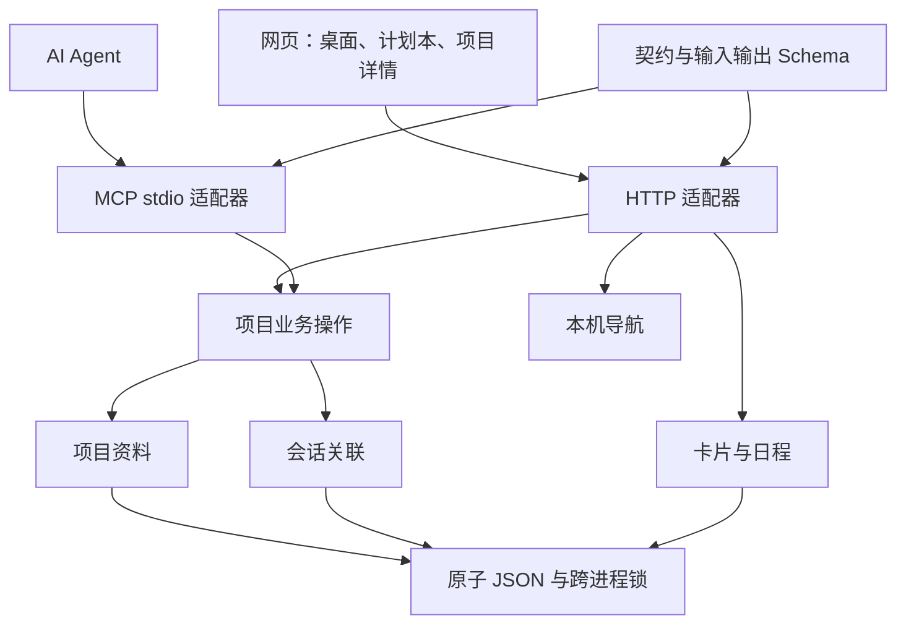

# 架构、部署与迁移

AI4S 工作台将日程安排、项目资料和分析文件引用集中到本地页面。应用不绑定特定物种、研究课题、文件根目录或 SSH 主机。运行时全部使用 Python 标准库和浏览器原生 HTML/CSS/JavaScript。

## 模块划分



| 文件 | 单一职责 |
|---|---|
| `desktop_runtime.py` | 工作区配置、路径解析、路径映射 |
| `desktop_storage.py` | JSON 读写、原子替换与同机进程锁 |
| `desktop_repository.py` | 合并生成摘要和人工项目登记、解析项目地址 |
| `desktop_addresses.py` | 校验附加命名地址，解析本地路径、服务器别名及网页链接 |
| `desktop_links.py` | 项目与会话关联、独立关联版本 |
| `desktop_state.py` | 卡片、单层文件夹、待办及布局版本 |
| `desktop_services.py` | 项目查询、新建、修改、归档恢复和汇总 |
| `desktop_contract.py` | v1 路由、工具定义、JSON Schema、OpenAPI |
| `desktop_server.py` | HTTP、静态页面、可选文件查询、导航和刷新入口 |
| `desktop_mcp.py` | MCP 生命周期、工具调用、文档资源 |
| `desktop_navigation.py` | Windows/macOS/Linux 系统打开命令 |
| `desktop_manage.py` | 初始化工作区、迁移打包、生成 MCP 客户端配置 |
| `deploy.ps1` / `deploy.sh` | 发现并复用满足 Python >=3.9,<4.0 的解释器 |
| `deploy.py` | 工作区部署、HTTP/MCP 自检、服务启停和运行记录 |
| `deploy_codex.py` | 官方 CLI 注册适配、配置字节备份、校验和失败恢复 |
| `desktop/app.js` | 项目资料、结果和文件查询视图 |
| `desktop/board.js` | 拖放、文件夹、计划本 |
| `desktop/details.js` | 结构化详情、项目编辑和会话关联 |

前端和 MCP 不直接修改研究文件。数据适配器由用户在工作区配置中明确指定，与核心程序分开。状态卡片没有默认后台计算任务；没有接入适配器时，进度由用户或 Agent 更新。

## 工作区配置

使用 `python desktop_manage.py init ../research-workspace` 创建目录：

```text
research-workspace/
  workspace.json
  data/
    desktop_projects.json
    desktop_project_links.json      # 首次关联时生成
    desktop_board_state.json        # 首次保存桌面时生成
```

```json
{
  "schema_version": 1,
  "name": "AI4S工作台",
  "data_dir": "data",
  "workspace_root": ".",
  "port": 8828,
  "ssh_alias": "",
  "path_mappings": [],
  "refresh_command": []
}
```

所有配置中的相对目录以 `workspace.json` 所在目录为基准，跟启动命令所在位置无关。项目的相对 `local` 地址以 `workspace_root` 为基准。`name` 是工作区元数据；页面产品名固定为 AI4S工作台。项目可单独设置 SSH 别名，留空则使用工作区默认值。

网页服务：

```bash
python -B desktop_server.py --config ../research-workspace/workspace.json --open
```

命令行 `--port 8833` 可临时覆盖配置；`--data-dir` 可覆盖数据目录。默认只监听本机。退出前台服务按 `Ctrl+C`；后台服务应由启动者保存进程号，并只停止对应进程。不要按 Python 进程名称批量结束任务。

MCP 是独立进程，不依赖 HTTP 服务。多个 MCP 客户端与网页可以共享一个本地工作区，写入通过进程锁串行处理，过期 revision 返回冲突。不要把工作区当作多台电脑同时写入的共享网络数据库。

## 迁移与发布包

```bash
python desktop_manage.py pack --config ../research-workspace/workspace.json --output ../ai4s-portable.zip
```

默认包包含应用、接口文档、项目摘要、人工登记、会话关联和当前布局。研究数据、Python 环境、日志、截图和逐文件 SQLite 索引不会进入包。加入 `--include-index` 可额外携带当前文件索引和已有导出清单。

解压后执行 `python -B desktop_server.py --config workspace.json --open`，Windows 也可双击 `start.cmd`。目标电脑仍需安装 Python。发布包不内嵌解释器。

包保留原目录引用。换电脑后，在 `workspace.json` 中添加映射：

```json
[
  {"host":"local","from":"D:/research","to":"E:/research"},
  {"host":"server","from":"/old/projects","to":"/srv/projects"}
]
```

上述数组填写到 `path_mappings`。映射按最长前缀匹配，不修改原始登记或项目 ID，也不会复制数据。打包会清空 `refresh_command`，迁移后按新环境重新配置。MCP 配置含绝对路径，也需重新生成。

发布到公共代码仓库时只发布程序、文档和虚构演示数据。普通 `pack` 是个人迁移工具，包内会包含用户项目资料；不要直接把个人迁移包当作公开演示包。

## 数据适配器

可选 `refresh_command` 是可信本地命令的参数数组，不经过 shell。允许 `{python}`、`{app_dir}`、`{data_dir}`、`{workspace_root}` 占位符。例如：

```json
["{python}","/absolute/path/my_adapter.py","--output","{data_dir}"]
```

适配器负责生成 `desktop_data.json`，需要逐文件查询时再生成约定的 SQLite 文件。工作台不推断科研结论。应保留输入、结果版本、用途依据和观察时间，明确区分人工采用状态与计算任务的运行状态。

模型与索引字段见 [数据接入约定](docs/DATA_MODEL.md)。

## 扩展原则

1. 新的 Agent 操作先在 `desktop_services.py` 定义业务行为，再由 `desktop_contract.py` 声明输入输出；HTTP 和 MCP 仅做适配。
2. 新的科研数据来源写成外部适配器，不把领域分析脚本导入服务核心。
3. 新会话平台放在独立导航适配器中，复用项目资料，不嵌入完整聊天 SDK。
4. 输入不兼容变更应使用新的 API/Schema 版本；保持稳定 ID 和可恢复的数据迁移。
5. 修改契约后运行 `python examples/export_openapi.py`，提交生成的 `openapi.json`，并运行测试。

目前采用 MCP 初始化会话协议，支持协商 `2025-11-25`、`2025-06-18`、`2025-03-26`、`2024-11-05`；未实现 2026 stateless 协议。参考 [MCP stdio](https://modelcontextprotocol.io/specification/2025-11-25/basic/transports)。
