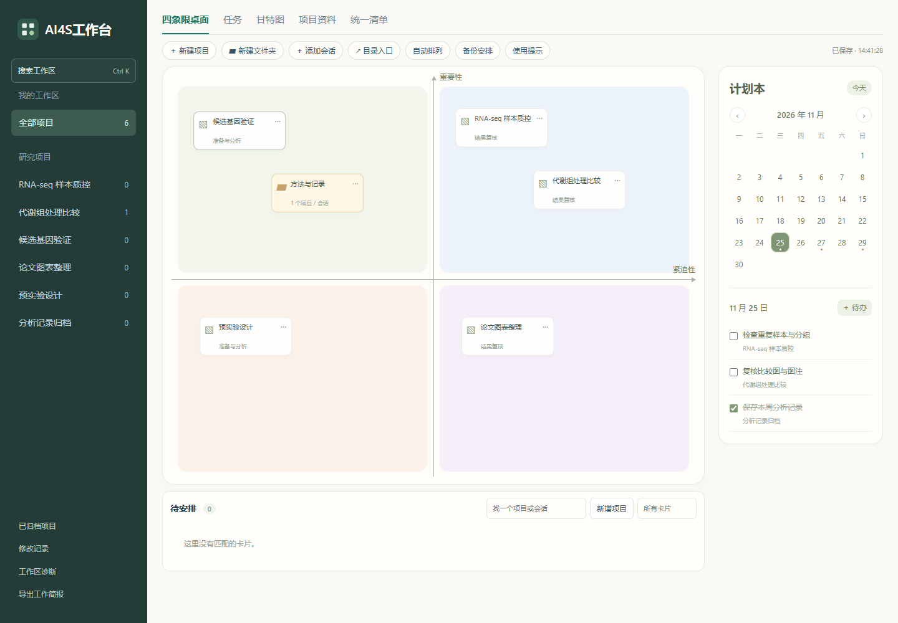
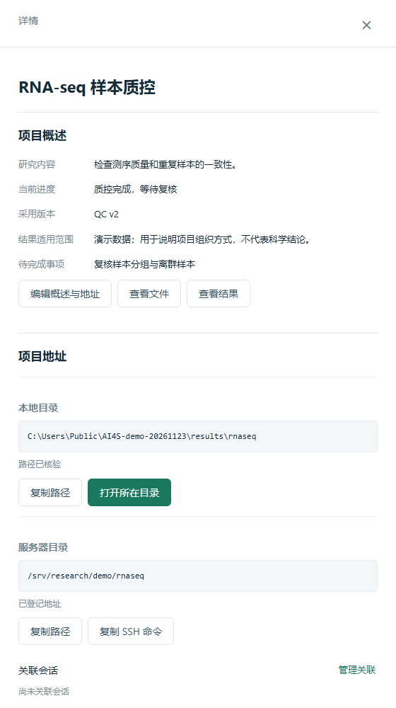
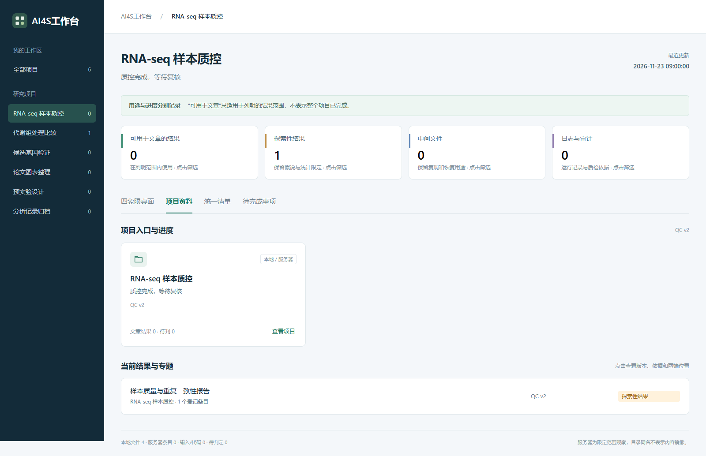

# AI4S工作台 · Bioinformatics Calendar

一个面向科研分析人员的本地日程与项目桌面。把同时进行的分析放到一张桌面上，安排下一步工作，快速了解每个项目的进度、当前采用版本和结果位置。

分析文件往往分散在本机、服务器和多段 AI 会话中。本项目保存这些位置与说明，让分析人员通过四象限、项目文件夹和计划本组织工作，再从项目详情进入结果目录或关联会话。



## 主要功能

- **安排工作**：自由拖放项目和会话卡片，横轴表示紧迫性，纵轴表示重要性。用文件夹组织相关工作。
- **计划本**：按日期记录待办、关联项目、勾选完成。计划不会自动启动分析或发送提醒。
- **理解项目**：详情分为“项目概述”和“项目地址”，展示研究内容、进度、采用版本、适用范围、待办及本地／服务器目录。
- **查找结果**：可接入结果包摘要与逐文件索引，区分文章结果、探索性结果、中间文件和日志。
- **返回会话**：关联 Codex 会话，从详情直接调用本机客户端打开对话。
- **Agent 管理**：MCP 提供项目增改、查询、归档恢复、资料汇总和会话关联。HTTP 与 MCP 使用同一组业务操作和 Schema。
- **同步已有工作**：授权 Agent 整理当前会话或指定项目目录中的进度、结果版本和待办，通过 MCP 登记到工作台。

这里显示的状态来自人工登记或你配置的数据适配器。当前版本不自动读取 SLURM、计算进程或 Codex 会话的实时运行状态，也不会把探索性分析自动认定为最终结果。

## 快速开始

### 一句话快速部署

复制下面这句话交给 Agent：

> 请克隆或更新 https://github.com/YeeLuii/Bioinformatics-calendar ，按 docs/DEPLOYMENT.md 在 Windows 运行 `powershell -NoProfile -ExecutionPolicy Bypass -File .\deploy.ps1 --mcp required --no-open`，在 macOS/Linux 运行 `sh ./deploy.sh --mcp required --no-open`；复用满足 Python >=3.9,<4.0 的已有环境，配置 MCP 只通过脚本调用官方 `codex mcp add`，不手工修改 config.toml，不自行安装运行时；根据脚本输出告知地址和启停方法，失败时报告原因，成功后询问我“是否要分析当前会话和项目的分析进度并同步到工作台？”，得到同意后按确认范围同步。

这里的“已有工作区”指已经使用过的 AI4S 工作区。首次部署时会创建新工作区；再次部署时保留其中的项目、日程、会话关联和设置，不会因此自动导入 Codex 的全部会话。首次同步的询问由部署 Agent 执行，当前网页启动时没有自动扫描或导入弹窗。

### 运行部署脚本

需要 **Python >=3.9,<4.0** 和现代浏览器。脚本检查已有解释器及所需标准库，不要求特定小版本，不下载 Python，也不默认创建虚拟环境。工作台本身无需 pip、npm、数据库服务或前端构建；注册 Codex MCP 另外需要可用的 Codex CLI。

```bash
git clone https://github.com/YeeLuii/Bioinformatics-calendar.git
cd Bioinformatics-calendar
```

Windows：

```powershell
powershell -NoProfile -ExecutionPolicy Bypass -File .\deploy.ps1 --mcp required
```

macOS / Linux：

```sh
sh ./deploy.sh --mcp required
```

脚本创建或复用仓库同级的 ai4s-workspace，验证网页和 MCP，并打开浏览器。端口被占用时选择空闲端口，以输出地址为准。仅需要网页时使用 `--mcp off`。在页面点击“新建项目”，填写项目内容和目录，再将卡片拖到合适位置。

```bash
python -B deploy.py status
python -B deploy.py stop
```

自定义工作区时，启停都带相同的 `--workspace PATH`。更新代码后加 `--restart` 重新启动。完整参数、配置保护和失败处理见 [部署说明](docs/DEPLOYMENT.md)。

应用代码与个人工作区分开。研究数据保持原位；项目归档、卡片摆放和文件夹操作只修改工作区元数据。

### 先体验演示

```bash
python examples/create_demo.py --destination ../ai4s-demo
python -B desktop_server.py --config ../ai4s-demo/workspace.json --open
```

演示生成器创建 6 个虚构分析项目、结果示例、卡片与本周待办；不会连接服务器。默认演示端口为 8841。已有目标目录不会被覆盖。

## 如何同步或添加工作

### 名称与调用方式

| 用途 | 名称 |
|---|---|
| 面向用户的调用名称、技能显示名 | **ai4s项目桌面** |
| MCP 注册名 | `ai4s` |
| 可选技能的显式调用 | `$ai4s` |
| 技能识别的自然语言叫法 | 项目工作台、项目桌面、科研日程管理、AI4S工作台、ai4s |

部署脚本的 `--mcp required` 会注册 MCP；同名同路径的配置会直接复用。可用 `codex mcp get ai4s --json` 检查注册内容，再重载客户端以发现工具。注册记录存在不代表当前会话已加载，Agent 应实际调用 `workspace_status` 和 `projects_list` 验证连接。

技能负责识别名称并指导操作，MCP 提供实际接口。需要 `$ai4s` 和上述近义词识别时，按 [技能安装说明](docs/DEPLOYMENT.md#可选技能与近义词调用) 安装仓库提供的通用技能。部署脚本目前不自动安装技能，也不为每个近义词创建重复的 MCP 服务。

安装后可以说：

> 请用项目工作台更新这个项目的进度，保留其他项目和日程。

或显式调用：

> $ai4s 请列出我的科研项目，汇总当前采用版本和待完成事项。

名称识别仍由 Agent 根据上下文选择；需要明确指定时使用 `$ai4s`。

### 同步已有工作

**首次同步。** 部署完成后，Agent 询问是否整理已有工作；你可以选择仅同步当前会话、指定会话和项目目录，或暂不导入。Agent 根据授权且能够读取的会话记录、README 和结果说明，整理项目概述、当前进度、采用版本、结果位置与下一步，通过 MCP 新建或更新项目，并关联已有会话。一个研究项目可以关联多个会话，不必为每段对话重复建项目。

可以直接对 Agent 说：

> 请把当前会话和我指定项目目录中的分析工作同步到 AI4S 工作台，先核对已登记项目，再补充进度、采用版本、结果目录和待办，并注明信息来源与整理时间；无法确认的进度标为待核实。

**手动添加。** 点击“新建项目”填写资料，在详情中添加目录和会话关联；再把卡片拖到四象限，在计划本中安排具体日期。MCP 导入的项目先出现在左侧列表，已有桌面可在项目详情点击“加入桌面”。

**后续更新。** 可以说“请根据这次分析的新记录更新该项目的进度、结果版本和下一步”，或直接在详情中编辑。Agent 应读取本轮新资料再更新；`project_summarize` 只汇总已登记内容，不会自行获取新进展。网页定期检查资料变化，但重新启动程序不会自动遍历所有 Codex 会话。

同步范围取决于 Agent 实际可访问的资料；无法读取其他会话时，可使用当前对话和你提供的项目说明。持续更新文件位置与清单，需要另外配置 [数据适配器](AI4S_ARCHITECTURE.md#数据适配器)。

## 界面展示

| 项目概述与地址 | 按项目浏览结果 |
|---|---|
|  |  |

本地项目不显示服务器入口。

## 三个常见用法

**同时开展多项分析。** 新建“RNA-seq 质控”“代谢组比较”“候选基因验证”等项目，分别填写当前进度和下一步。把本周需要检查的项目放到右上方，将需要长期准备的项目放到左上方。

**安排一次结果复核。** 在计划本选中日期，新建“检查重复样本并确认差异分析版本”，关联 RNA-seq 项目。点击待办的关联入口即可返回项目；完成后勾选待办，并更新项目进度。

**让 Agent 汇报研究进展。** 接入 MCP 后，可以说：“列出当前项目，汇总采用版本和未完成事项；把已结束的试验归档，保留文件。”Agent 先读取 revision，再按用户指令调用对应工具。汇总仅使用已登记资料。

更完整的操作步骤、HTTP 示例和运行方式见 [使用指南](docs/USAGE.md)。

## 接口与部署

| 文档 | 内容 |
|---|---|
| [完整接口说明](docs/API.md) | HTTP、MCP、鉴权、字段、错误、版本冲突、桌面与文件接口 |
| [自动部署与兼容性](docs/DEPLOYMENT.md) | 环境检查、脚本参数、启停、Codex 配置备份与失败恢复 |
| [Agent 操作说明](AGENT_API.md) | Agent 调用顺序、工具边界和恢复方式 |
| [OpenAPI 3.1](openapi.json) | 稳定 v1 项目接口及 10 个 MCP 工具的输入输出 Schema |
| [架构与部署](AI4S_ARCHITECTURE.md) | 模块职责、配置、迁移、打包及扩展方式 |
| [数据接入约定](docs/DATA_MODEL.md) | 项目、结果包、卡片、待办及可选文件索引 |

MCP 不需要先启动网页。Codex 注册由部署脚本完成；其他客户端可生成配置参考：

```bash
python desktop_manage.py mcp-config --config ../ai4s-workspace/workspace.json
```

JSON 片段供支持 mcpServers 格式的客户端使用。生成片段本身不会注册服务；客户端通过 stdio 启动 `desktop_mcp.py`。Codex 请使用部署脚本，避免手工编辑 TOML。迁移后重新运行脚本，并根据需要明确替换旧的同名注册。

## 提问与贡献

- [Issues：提问、反馈问题和提出功能建议](https://github.com/YeeLuii/Bioinformatics-calendar/issues)
- [Pull requests：提交代码或文档改进](https://github.com/YeeLuii/Bioinformatics-calendar/pulls)

## 测试与适用范围

```bash
python -B -m unittest discover -p "test_*.py" -v
```

测试覆盖空工作区、路径映射、日程与布局保存、项目增改归档、真实 MCP 通信、跨进程版本冲突、HTTP、迁移包及部署启动、重复运行和配置恢复。GitHub Actions 配置 Windows/Linux 与 Python 3.9/3.12/3.14 的测试矩阵；注册测试使用模拟 CLI，不改动真实 Codex 配置。Windows 本机导航已实际验证；macOS 和其他系统的目录打开命令仍需对应环境验证。

当前面向单用户本地工作。只监听 `127.0.0.1`，没有多用户权限、远程 MCP 或在线聊天代理。可保存多个分析项目，但不承担集群作业调度。Codex 跳转需要本机安装客户端并能访问目标会话。
